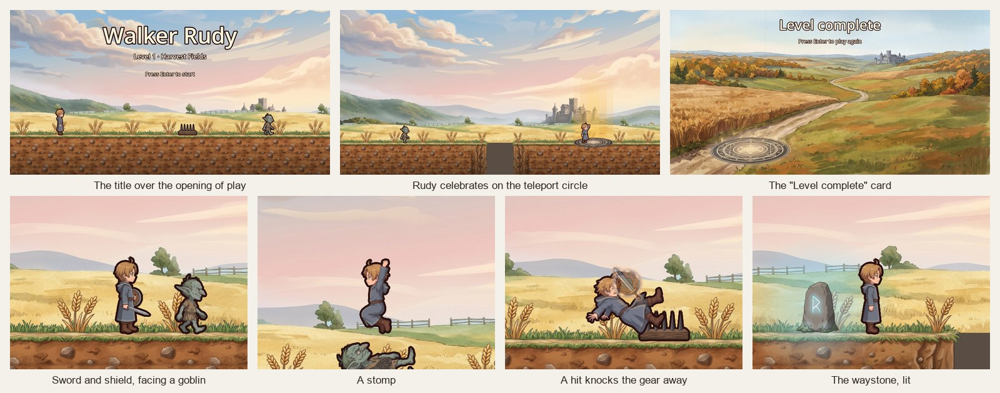
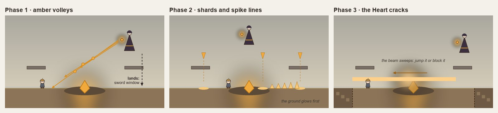
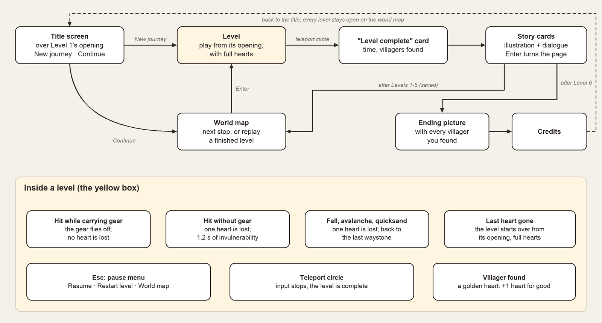
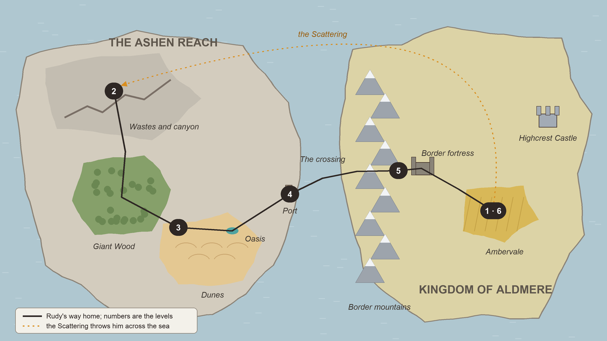
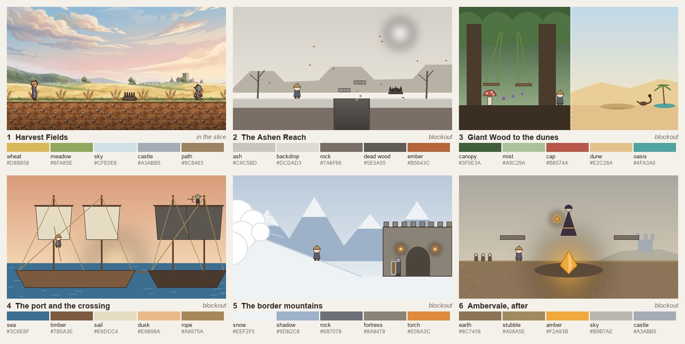
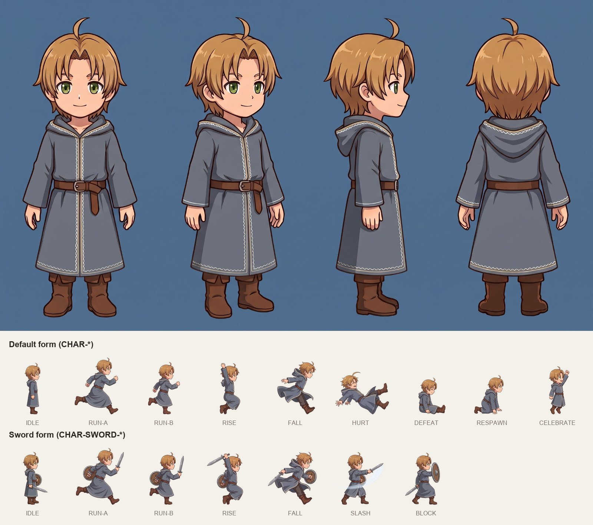
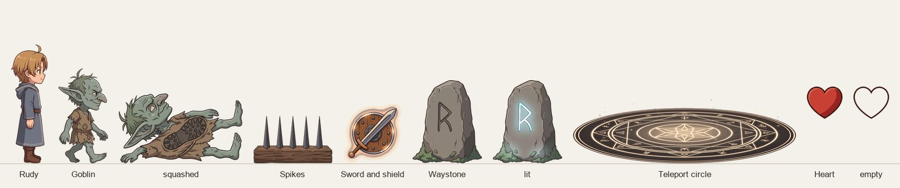

# Walker Rudy: The Long Way Home — Game Design Document

## 0. Metadata

| | |
|---|---|
| Version | **v2, draft**, 2026-11-23 |
| Author | Shuai Zhang |
| Based on | v1, my Assignment 4 GDD (2026-10-19, submitted on Canvas as a PDF) |
| Used for | the Assignment 8 pitch film; the final project is planned from section 12 |
| Section order | the GDD tool Zelda's: metadata, vision, then sixteen sections, with art direction (10) and sound and music (11) added as Assignment 8 asks |

*Restructured and updated by Claude Code (Claude Opus 5.5) from my v1, our conversation of 2026-11-20 to 2026-11-23 and this repository's code at tag `a7`. It follows the section order of the course's GDD tool, Walker's Zelda `gdd` skill (the Walker repository at commit `a596b23`, 2026-11-21). Claude wrote it in one pass. It did not run the skill's intake command by command, and none of the skill's four human gates is signed. The design decisions are mine. "Changes from version 1", at the end, lists what is new here and which of it I have not confirmed yet.*

**Status labels.** **Built** means it is in the game at tag `a7` (`76206412`) and was tested there; its numbers come from that code. **Designed** means it exists only in this document, and its numbers are tuning guesses to be checked by playtesting. Section 12 tags each feature *must*, *should* or *could* for the final project, and section 13 lists what the final will not do.

| | |
|---|---|
| Genre | 2D side-scrolling action platformer with a story |
| Player | one player, keyboard only |
| Platform | Web (HTML5 on WebGL 2) as the export target; macOS, where the game runs and is tested today |
| Engine | Godot 4.7.2, GDScript, the GL Compatibility renderer |
| Length | six levels; about 20 to 25 minutes for a first run (an estimate) |
| Audience | players aged about 10 and up who like short, readable platformers with a story |
| Tone | warm, with weight: separation, loss and growing up, ending in hope |
| Built so far | Level 1 as a playable slice (Assignment 2), with a shader (a5), particle effects (a6) and animation states (a7) added since |

## Vision: the game in brief

**What is the game?** *Walker Rudy: The Long Way Home.* The player runs, jumps and stomps through six side-scrolling levels as Rudy, a ten-year-old mage, and fights with a sword and shield up close or a magic staff from range.

**What is the goal?** Each level is won by reaching the teleport circle at its end; the game is won by defeating the archmage Aldric Voss at the end of Level 6 and freeing Rudy's family. Nothing ends the game: losing the last heart starts the level over from its opening. A side goal is to find the four lost villagers, one in each of Levels 2–5, for a golden heart each.

**In the tool's own sentence.** This game is a short story platformer for players of about 10 and up who like readable challenges, that delivers a journey home where a mistake stings but never ends the game, through running, jumping and stomping, with gear that a hit knocks away first.

*Figure 1. Level 1, the only level that runs. In-game screenshots from the Assignment 2 slice; the art in them is generated (section 10).*

**The story in two sentences.** Rudy Hollin, from the farming village of Ambervale, is thrown across the world when the court archmage's ritual goes wrong, and must cross ash wastes, a giant forest, a desert, the sea and a mountain border to get home. He runs, jumps and stomps; with a sword and shield or a magic staff he can also fight and block, until a hit knocks the gear away.

## 1. Design pillars

The four pillars are the ones from Assignment 2's concept. Every feature has to serve at least one.

| Pillar | The promise to the player | How the game keeps it |
|---|---|---|
| **P1 — Your gear is your plan** | Picking the sword or the staff changes how you deal with what is ahead | From Level 4 a sword stand and a staff stand sit before each hard stretch. Archers favour the staff; beetles and shield guards favour the sword. The boss can be beaten with either |
| **P2 — Read every threat** | It is always obvious when an enemy is attacking, and from where | Every attack has a tell: the archer draws, the mushroom swells, the sand ripples over a scorpion, the guard turns slowly, the ground glows before Voss's shards land |
| **P3 — It stings, then you try again** | A mistake costs something, but never makes you want to quit | Gear is lost before hearts; every level starts with full hearts; there are no lives and no game over |
| **P4 — A journey into another world** | The world feels bigger than the path you are on, and worth crossing | Six regions, each with its own light and palette. The castle on Level 1's horizon is where the trouble started. (v1 also gave each region its own arrangement of the music and a world map showing how far Rudy has come; neither is in the final project, section 13) |

## 2. Core gameplay loop

| Scale | What the player does | What they decide |
|---|---|---|
| **Moment to moment** (seconds) | Cross a short stretch of cliffs, hazards and monsters to the next safe ground | Avoid or fight: jump past an enemy, stomp it, or, with gear, cut it down or shoot it. Block a shot from the front, or step out of its path |
| **One sitting** (a level, 2–4 minutes) | Play from the level's opening, with full hearts, past its waystones to the teleport circle; the "Level complete" card shows the time | At each stand, which gear to carry into the next stretch (P1). At each side path, whether a health pack or a villager is worth the risk |
| **What brings them back** | The next region and its new idea; Continue picks up at the next level; a better time | Whether to restart a level from the pause menu for a better time, or to go on |

**The risk in every scale.** Any hit knocks the gear away first and costs one of Rudy's hearts after that. A fall costs a heart and sends him back to the last waystone. When his last heart goes, the level starts over.

## 3. Player experience goals

Each goal names the pillar it serves and how it will be checked. Feelings cannot be checked by a headless test, so each one is checked by a human playtest, with the sound on and with it off.

| ID | The player should feel… | when… | Pillar | Checked by |
|---|---|---|---|---|
| PX-01 | quick and in control | running and jumping Level 1's fields at full speed | the core loop | my playtest; the run's numbers are pinned by tests (built) |
| PX-02 | warned in time | an attack is coming: its tell came first | P2 | my playtest, muted: every attack read from its tell alone |
| PX-03 | stung, but ready to try again | a hit takes the gear, or the last heart sends them back | P3 | my playtest: whether a retry starts within a few seconds |
| PX-04 | that the choice mattered | they pick the sword or the staff at a stand before a hard stretch | P1 | my playtest of Levels 4–6 with each gear |
| PX-05 | that the world is big and worth crossing | a new region opens | P4 | my playtest; the contrast check keeps Rudy readable in it (section 10) |
| PX-06 | rewarded for a risk | a detour pays off with a health pack or a villager | P1, P3 | my playtest of each detour |
| PX-07 | that they learned the fight | they beat Voss after reading his phases | P2 | my playtest of the boss with each gear |

## 4. Core mechanics

**Controls.**

| Action | Keys | Status |
|---|---|---|
| Move | A / D, ← / → | Built |
| Jump | Space, W, ↑ | Built |
| Attack: the sword's slash, or the staff's bolt | J, X | Built (slash); designed (bolt) |
| Block: the shield, or the staff's barrier | hold K or C | Designed |
| Climb a rope | W / S or ↑ / ↓ on a rope; Space jumps off | Designed |
| Pause | Esc | Built |
| Mute the music / the sound effects | M / N | Built |
| Confirm on the title and end card | Enter | Built |
| Choose in a menu | ↑ / ↓, then Enter | Designed |
| Show the debug line | F1 | Built; for development |

**The mechanics.** Each has its rule and what happens at its edges. Built edges come from `game/content/rudy/rudy.gd` and the Assignment 7 edge test at tag `a7`.

| ID | Mechanic | Rule | At the edges | Status |
|---|---|---|---|---|
| M-01 | **Run** | 560 px/s, reached or stopped in 0.1 s | On the ground, a tap of the other direction turns Rudy on the spot; he moves that way only if the key is held for 0.12 s. In the air he faces the new way at once and changes speed at the same 0.1 s rate. During a knockback the push carries him until he lands | Built |
| M-02 | **Jump** | 1500 px/s upward, with gravity 4000 px/s² rising and 6400 px/s² falling: the top is 294 px up, after 0.38 s, and the fall takes 0.32 s | Only a fresh press with ground underfoot jumps: holding the key cannot jump again, there is no double jump, and there is no grace time after leaving a ledge | Built |
| M-03 | **Stomp** | Landing on a stompable enemy from above defeats it, and Rudy bounces up at 600 px/s | The beetle cannot be stomped: landing on it hurts Rudy. A scorpion can be stomped only once it is out of the sand, and a shield guard only on the helmet | Built for the goblin; designed for the others |
| M-04 | **Slash** | A 0.3 s swing whose hitbox, 50 px in front of him, is live from 0.03 to 0.18 s. One cut defeats a goblin | Only with the sword, and only on a fresh press. No new swing starts until the last one ends; a re-press during the swing is ignored. A hit ends the swing on its tick. He can slash in the air | Built; edges tested (108 checks at 60 fps) |
| M-05 | **Block** | Hold to raise the shield, or the barrier with the staff, toward the way he faces. It stops spores, arrows, amber bolts and Voss's beam, but not touching an enemy | He walks at half speed and cannot attack while blocking. A shot from behind is not blocked. Blocking Voss's beam pushes him back 200 px. Blocking in the air is not decided yet (Q-07) | Designed; the block frame exists |
| M-06 | **Staff bolt** | One bolt per press, at most one every 0.3 s. It flies straight ahead at 1100 px/s for up to 900 px, and stops at the first enemy. Two bolts defeat a goblin | One bolt defeats an archer. A shield guard's shield stops bolts from the front. A bolt that hits nothing ends at 900 px | Designed |
| M-07 | **Climb** | Touching a rope in the air grabs it. ↑ / ↓ climb at 300 px/s; Space jumps off to the side | No attacks while climbing. As anywhere, a hit takes the gear before a heart; whether it also knocks him off the rope is not decided yet (Q-07) | Designed |
| M-08 | **Gear pickup and swap** | Rudy carries one piece of gear or none. A stand holds one item; touching it while carrying the other swaps them | A stand he empties stays empty until his next respawn. He starts every level, and gets back up after every respawn, without gear | Built for the one sword pickup; stands and the swap designed |
| M-09 | **Taking a hit** | Rudy turns toward the hit and is knocked back at (350, 400) px/s, loses control for 0.35 s, and is invulnerable for 1.2 s, flashing. With gear, the gear flies off and no heart is lost; without, one heart is lost | Only his body's capsule counts, so a shot that grazes his hair or shield misses. Hits during the 1.2 s are ignored. A hit takes the last heart only when he has no gear | Built |
| M-10 | **Falling** | A fall out of the level costs one heart; Rudy gets back up at the last lit waystone, or the level's start, with the hearts he has left | Every enemy and pickup is back where it started. Sinking all the way into quicksand (Level 3) and being caught by the avalanche (Level 5) count as falls. In Voss's arena a fall puts him back on the arena floor and the fight carries on | Built for falls; designed for quicksand, the avalanche and the arena |
| M-11 | **Losing and restarting** | When the last heart goes, by a hit or a fall, the level starts over from its opening, with full hearts | The waystones are dark again and every enemy and pickup is back. A villager found in the failed attempt is back in their spot and the golden heart is undone. There is no game over and there are no lives | Built for Level 1; the villager rule designed |
| M-12 | **Pause** | Esc pauses the game, shows "Paused" over a dimmed screen and drops the music 12 dB | Designed addition: a menu with Resume, Restart level and Title. Title loses the progress in the current level | Built ("Paused"); menu designed |
| M-13 | **Camera** | Follows Rudy sideways only, so the ground stays at the same height on screen; shakes for 0.2 s (8 px) on a hit | Levels 4 and 5 add a vertical follow with a dead zone, for the masts and the mountain slope. In the avalanche chase the screen scrolls on its own at 480 px/s | Built; vertical follow and the scroll designed |

## 5. Systems

| ID | System | Why it exists | Its main variables | Status |
|---|---|---|---|---|
| S-01 | **Gear and damage** | P1 and P3: gear is both the plan and the buffer before hearts | gear (none, sword, staff); damage per hit; invulnerability 1.2 s | Built for none and sword; staff designed |
| S-02 | **Hearts and healing** | P3: a mistake costs something, never everything | 3 hearts at the start, +1 for each villager found (up to 7); a health pack restores one, and does nothing at full health | Built for 3 hearts; packs and golden hearts designed |
| S-03 | **Checkpoints and respawn** | P3: a fall sends Rudy back a little, not to the start | waystones per level (1 in Level 1, 2 in Levels 2–5, 1 in Level 6); respawn takes 0.7 s | Built |
| S-04 | **Enemies** | P2: every attack has a tell; each enemy asks a different answer | the table below | Built for the goblin; the rest designed |
| S-05 | **The boss** | P2 and P1: a fight that teaches its patterns, and can be won with either gear | Voss's health 24; phase thresholds 16 and 8; each phase's timings in a data table | Designed |
| S-06 | **Level flow** | Six levels played in order, from the title to the credits | the level's states TITLE → PLAYING ⇄ DYING → COMPLETE; the level's time | Built for Level 1; the sequence designed |
| S-07 | **Saving** | Continue picks up where the player stopped | levels completed, each level's best time, villagers found, maximum hearts, mute settings | Designed |
| S-08 | **Sound feedback** | Every event the player must notice is heard, and also seen | one entry point `Sfx.play(id)`; the music's dips | Built (section 11) |

**S-04, the enemies.** After any death, every enemy is back where it started, the defeated ones too (built for the goblins). Each enemy's states are a small state machine (designed): the mushroom IDLE → SWELLING → PUFFING; the scorpion BURIED → EMERGING → CHASING; the archer IDLE → DRAWING → SHOOTING; the guard MARCHING → TURNING. One of them will be driven by the game-AI technique I choose in Assignment 9; my first candidate is the scorpion.

| Enemy | Levels | Behaviour | Its tell | Stomp | Sword | Staff | Block its attack? |
|---|---|---|---|---|---|---|---|
| Goblin | 1, 2, 4 | patrols back and forth | — | yes | 1 hit | 2 hits | — (it hurts by touch) |
| Thorn-back ash beetle | 2 | crawls slowly; turns at ledges | the spikes on its back | **no**: it hurts | 1 | 2 | — |
| Mushroom monster | 3 | rooted; aims at Rudy and puffs a spore every 2.5 s | its cap swells for 0.5 s | yes | 1 | 2 | yes; spores cannot be cut |
| Sand scorpion | 3 | buried; bursts out when Rudy is within 250 px, then chases | a ripple in the sand above it | yes, once it is out | 1 | 2 | — |
| Goblin archer | 4 | stands on yards and decks; shoots every 2 s | draws the bow for 0.6 s | yes | 1 | 1 | yes |
| Shield guard | 5, 6 | marches; turns to face Rudy 0.8 s after he passes it | its big shield faces front | yes, on the helmet | 1 from behind; blocked in front | 2 from behind; blocked in front | — |
| Aldric Voss | 6 | the boss (S-05) | glows before every attack | no | 2 damage | 1 damage | bolts and beam yes; shards and spikes no |

**S-05, the boss.** The arena is one screen wide, with the crater in the middle and two floating stone platforms. A slash does 2 damage and a bolt 1, so a sword fight needs 12 hits and a staff fight 24 bolts. His states are HOVER, TELEGRAPH, VOLLEY, SHARDS, SPIKES, BEAM, LAND, HURT and DEFEATED.

*Figure 2. Voss's three phases. Code-drawn diagrams, labelled constructed: not final art.*

| Phase | Voss's health | What he does | How Rudy hurts him |
|---|---|---|---|
| **1 · Amber volleys** | 24 to 17 | Hovers to one side, glows for 0.6 s, and fires a fan of three amber bolts every 2.5 s. After every third volley he lands for 2 s | Block or dodge the bolts. The staff hits him in the air; the sword hits him when he lands |
| **2 · Shards and spike lines** | 16 to 9 | Adds shard rain: three shards fall on spots that glow 0.8 s before. A line of crystal spikes rises out of the crater after the ground glows. He lands after every fourth attack, for 1.5 s | Shards and spikes cannot be blocked; read the glow and move |
| **3 · The Heart cracks** | 8 to 0 | The outer floor crumbles away, leaving the middle and the platforms. He sweeps a beam across at Rudy's head height, then lands for 1.5 s | Jump the beam or block it; blocking pushes Rudy back 200 px, toward the edge |

**S-06, level flow.** The title, a level, its "Level complete" card, the next level. The card shows the level's time and whether its villager was found, and Enter starts the next level. After Level 6, the credits, then the title.

*Figure 3. The game flow as v1 designed it. Code-drawn diagram. The story cards, the ending picture and the world map in it are not in the final project (section 13), so in the final the card leads straight to the next level, and the pause menu's third item is Title instead of World map.*

## 6. Progression

| # | Level | New idea | New gear or ability | Hearts possible on entry | Target length |
|---|---|---|---|---|---|
| 1 | Harvest Fields | run, jump, stomp, spikes, cliffs | the sword | 3 | about 13 s at full speed (built; measured) |
| 2 | The Ashen Reach | an enemy that cannot be stomped; ledges that fall | the first health pack | 3 | 2–3 min |
| 3 | Giant Wood to the dunes | shots to block; swinging and sinking ground; enemies that hide | the shield block | up to 4 | 3 min |
| 4 | The port and the crossing | enemies that shoot from above; climbing | the staff; ropes | up to 5 | 3 min |
| 5 | The border mountains | a chase that will not wait; enemies with a front | — | up to 6 | 3–4 min |
| 6 | Ambervale, after | a boss in three phases | — | up to 7 | 3 min |

- **Skill.** Each level brings in one or two new ideas, first in a safe place, then combined with earlier ones, so its last third mixes the new with the old.
- **Resources.** Hearts rise from 3 to at most 7, one for each villager found. Every level starts with full hearts. Gear is never kept between levels: each level gives it at its stands.
- **Challenge.** The enemies go from one that only touches (the goblin) to ones with tells (mushroom, scorpion, archer), to one with a front and a back (the guard), to the boss, whose phases combine them.
- **What a good player is good at:** timing and distance; reading tells; keeping the gear, so hearts are rarely lost; choosing the gear for what is ahead; facing and spacing; keeping moving on crumbling ledges, in quicksand and in front of the avalanche; judging when a detour is worth it; learning Voss's patterns.

## 7. World and environment

**The world.**

- **The Kingdom of Aldmere** is a quiet farming kingdom ruled from **Highcrest Castle**.
- **Ambervale** is a village in its heartland, known for fields of unusually golden wheat. Nobody there knows that **the Amber Heart**, an ancient mana crystal, lies under the fields.
- **The Ashen Reach** is a grey continent across the sea, of ash wastes, canyons, the Giant Wood and the dunes, with one port on its eastern coast. In Aldmere it is half a legend, and the Vahrn live there.
- **The Scattering** is the disaster that starts the game: when Voss's ritual fails, the Amber Heart's power throws every person and every building in Ambervale to random places across the world.
- **The rule of play:** the teleport circle at the end of every level is the "level complete" marker. The story does not explain it; between levels Rudy travels on foot and by ship.

*Figure 4. The world and Rudy's route; the numbers are the levels. Code-drawn schematic, labelled constructed: not final art, and not in the game.*

*Figure 5. The six levels. Level 1 is an in-game screenshot of the slice; Levels 2–6 are code-drawn blockouts, labelled constructed: not final art. Under each is its planned palette.*

| # | Level | Region | New challenge | Gear | Waystones | Lost villager | Target length |
|---|---|---|---|---|---|---|---|
| 1 | **Harvest Fields** | Ambervale, an autumn afternoon | run, jump, stomp, spikes, cliffs, the sword | one sword pickup | 1 | — | about 13 s at full speed (built; measured) |
| 2 | **The Ashen Reach** | ash wastes and a canyon | the beetle; crumbling ledges; the first health pack | 2 sword stands | 2 | the miller | 2–3 min |
| 3 | **Giant Wood to the dunes** | forest, then desert, to an oasis | mushrooms and blocking; swaying vines; quicksand; scorpions | 2 sword stands | 2 | the shepherd girl | 3 min |
| 4 | **The port and the crossing** | the docks, then two ships at sea | archers; ropes and rigging; the first level with both kinds of gear | 2 sword, 2 staff | 2 | the baker's boy | 3 min |
| 5 | **The border mountains** | the pass, then the border fortress | the avalanche chase; shield guards | both at the fortress | 2 | the blacksmith | 3–4 min |
| 6 | **Ambervale, after** | the empty fields and the crater | Aldric Voss, in three phases | both at the arena | 1 | — | 3 min |

**Level 1 — Harvest Fields (built).** The wheat fields outside Ambervale on a clear autumn afternoon, with Highcrest Castle small on the horizon. As built: the title over the opening; spikes, then a goblin to stomp; the first cliff; the sword-and-shield pickup and goblins to cut down; the waystone; the second cliff; the teleport circle and the "Level complete" card. Three goblins, two sets of spikes, two cliffs. It teaches running, jumping, stomping, falls, the sword, and that a hit takes the gear first. It stays as built.

**Level 2 — The Ashen Reach.** Grey ash flats under a pale, hazy sun, dead trees, ember flecks, then a deep canyon. A tall horned figure stands on a far ridge in the background twice.
1. Open flats with grey goblins, to warm up.
2. The first beetle, alone on flat ground with room to jump it; the spikes on its back say "do not stomp" (P2).
3. A sword stand before a pair of beetles.
4. The canyon: crumbling ledges over a pit. A ledge cracks 0.6 s after Rudy lands on it, falls at 1.0 s, and is back after 3 s.
5. Waystone 1.
6. The way down: beetles on narrow ledges, and the first health pack on a crumbling detour.
7. **The miller**, stranded on a high ledge at the end of a chain of crumbling ledges.
8. Waystone 2, the climb out, and the teleport circle on the canyon's rim.

**Level 3 — Giant Wood to the dunes.** A forest of giant trunks in green shade with shafts of light; then the dunes at a hard, bright noon; it ends at an oasis.
1. The forest: the first mushroom faces a wall, so its swell and spore are seen from safety; then a mushroom ahead of Rudy, whose spores the shield blocks (blocking is new here); swaying vine planks, pendulums with a 3 s period and a 25° swing; **the shepherd girl**, high in the canopy, reached by vines past a mushroom; waystone 1 at the forest's edge.
2. The desert: quicksand pits, where Rudy sinks at 40 px/s and jumps only half as high; scorpions under ripples in the sand, then quicksand and scorpions together; a health pack on a dune crest; waystone 2; the teleport circle by the oasis water.

**Level 4 — The port and the crossing.** The port's docks and roofs at dusk, then the open sea, where the pirates' ship pulls alongside Rudy's.
1. The docks: the first staff stand, beside a sword stand (P1). Archers on the roofs show what the staff is for.
2. Boarding the ship. Waystone 1.
3. At sea: goblin pirates on the deck, archers on the yards. Ropes and rigging lead up the masts; climbing is new here.
4. Across the boarding plank to the pirates' ship, and up its rigging. Waystone 2.
5. **The baker's boy**, held captive in the pirates' crow's nest.
6. When the last archer on the pirates' ship falls, the teleport circle lights on its deck.

**Level 5 — The border mountains.** A cold, clear morning on the snowy pass, then the torch-lit stone of the border fortress, under Voss's amber banners.
1. The avalanche chase: the screen scrolls on its own at 480 px/s, a little slower than Rudy's 560 px/s, so a stop or a mistake lets the avalanche catch up. Gaps, rocks and fallen logs; goblins to stomp without losing speed. The road splits: on the slower, harder high road **the blacksmith** waits on a ledge. The chase ends at the foot of the pass. Waystone 1.
2. The fortress: a sword stand and a staff stand at the wall; shield guards on the walls and in the courtyards; a health pack on a tower; waystone 2; the teleport circle at the far gate.

**Level 6 — Ambervale, after.** An overcast sky over an empty, scarred plain where the village stood; an amber glow from the crater; captured villagers dig in the background. The approach (about 40 s): shield guards, crumbling ground at the edges of the dig, a health pack, then the waystone at the arena's entrance with a sword stand and a staff stand. Then the boss (S-05). Losing the last heart starts Level 6 over from its opening; the approach is short so a retry is quick.

## 8. Narrative

**Structure.** Linear, with no branches: one story told between the levels, the same for every player. Only the ending picture changes, showing every villager the player found.

| After | What happens in play | v1's story cards after the level |
|---|---|---|
| **Level 1** | An ordinary autumn afternoon. Rudy runs through the wheat to the teleport circle | The sky over Highcrest Castle turns amber; a wave of light rolls across the land, and Ambervale is gone. Rudy wakes alone in grey ash under a pale sun |
| **Level 2** | Rudy crosses the wastes and a canyon alone. Now and then a tall horned figure stands on a far ridge | Beetles corner him at the canyon's end, and a spear flashes: Garran. By the fire, Rudy is too frightened to eat, then too hungry not to |
| **Level 3** | Through the forest, out into the desert, to an oasis | The oasis is crowded with people from Aldmere, all telling the same story of amber light from the castle. Maren finds Rudy and gives him her staff, and stays to keep searching |
| **Level 4** | Rudy and Garran board a ship home. At sea, pirates come alongside | The ship lands at the foot of Aldmere's border mountains. The archmage's guards have closed the border fortress |
| **Level 5** | An avalanche chases them down the pass. While Garran draws the garrison at the front gate, Rudy gets through the fortress over its walls | Rudy learns that every returning villager is sent home to dig. At the far gate Garran stops: Aldmere will not let a Vahrn through. He sends Rudy home alone |
| **Level 6** | Ambervale is an empty plain. In a crater, Voss's prisoners dig at the glowing crystal. Rudy fights Voss | As Voss falls, Rudy pours his own magic into the crack and the crystal sinks back under the soil; Voss's own spell scatters him. Among the freed diggers are Hal and Elin. The ending picture: Rudy, his parents and every villager found sow the first wheat |

**Themes.** Home is people as much as a place. Fear of strangers, answered by kindness: the Vahrn everyone fears is the one who brings Rudy home. Taking versus tending: Voss tries to take the land's power; Rudy puts it back.

**In the final project.** The 14 story cards are out (section 13). The story then shows only in play: Level 1's castle, the horned figure on Level 2's ridge, Voss's banners in Level 5, the diggers and the boss in Level 6. A player of the final will not meet Garran, Maren or Rudy's parents, and the staff will come from the stands, not from Maren. If the reviewer judges the scope too small, the story cards are the first thing to add back.

## 9. Characters

*Figure 6. Rudy: his reference and the 16 game frames in the slice. Generated images (Gemini app, Assignment 2). Nothing in play shows the block frame yet.*

- **Rudy Hollin, the player character.** Ten years old, from Ambervale, the son of Hal and Elin. A gifted young mage who is only fair with the sword his father taught him. Curious, quick to help, braver than he feels. A cheerful chibi boy with light-brown hair, green eyes and a slate-grey knee-length robe that was his teacher Maren's; 160 px tall in play. *What he gives the player:* a small, quick body that is easy to read, and a reason to keep going: home. Run, jump and stomp, the sword and shield and the AnimationPlayer slash are built; the block, the staff and climbing are designed.
- **Aldric Voss, the boss.** The archmage of Highcrest Castle, tall and gaunt in dark robes embroidered with amber. He learned that the Amber Heart lies under Ambervale's fields and tried to teleport it into the castle; the failed ritual was the Scattering. Greedy and proud rather than monstrous. *What he gives the player:* the final test of reading tells (S-05).
- **The four lost villagers:** the miller (Level 2), the shepherd girl (Level 3), the baker's boy (Level 4) and the blacksmith (Level 5). Each waits at the end of a risky side path. *What they give the player:* a reason to take a risk, and a golden heart for it. They have roles but no names yet (Q-03).
- **Garran, the feared warrior** (story cards only). A Vahrn spearman, tall, grey-blue, with a single short horn; stern, speaks little, gentle with children. He finds Rudy after Level 2 and takes him as far as the border.
- **Maren Vale, Rudy's first teacher** (story cards only). A wandering mage who taught Rudy; at the oasis after Level 3 she gives him her staff.
- **Hal and Elin Hollin, Rudy's parents** (story cards only). A retired swordsman turned farmer, and the village healer. Freed when Rudy defeats Voss.
- **The enemies** are in S-04: the goblin, the beetle, the mushroom, the scorpion, the archer and the shield guard.

## 10. Art direction

*Figure 7. The Level 1 cast at one scale, as cut out for the slice. Generated images from Assignment 2.*

**Style.** The style is the one Assignment 2 set and the slice shows (figures 1, 6 and 7).

- **Characters** are chibi, in clean anime cel shading: fine, even linework, two tones under flat, neutral light, and a bold dark-brown outer outline, 4 px at game size. The game adds the outline with a shader (`systems/art/outline.gdshader`, built), so it is the same on every frame and every level.
- **Backgrounds** are painterly, with watercolour and gouache texture, natural light and a muted, warm, low-saturation palette. The play space stays free of busy scenery.
- **Why the split:** flat, outlined characters and attacks read at once against the soft painted world (P2), and the painted distance makes the world feel larger than the path (P4).
- **Frame:** 1920×1080, side view, with a far layer, a middle layer and the ground. Rudy is 160 px tall, 15% of the screen's height.
- **Rights:** nothing recalls a well-known game hero: no green tunic, no pointed cap, no pointed ears, no triangle emblem.

**Each level's look.**

| Level | Light | Materials | Mood |
|---|---|---|---|
| 1 Harvest Fields | clear autumn afternoon, low warm sun, long soft shadows | ripe wheat, meadow grass, fieldstone, old timber; the castle far away | quiet, warm, unhurried |
| 2 The Ashen Reach | overcast, a pale sun through ash haze | ash, cracked grey rock, dead wood, ember flecks | lonely and strange |
| 3 Giant Wood to the dunes | green shade with shafts of light, then a hard desert noon | giant bark, moss, mushroom caps; sand, palms, oasis water | wonder, then heat |
| 4 The port and the crossing | dusk at sea | wet timber, canvas sails, rope, dark water | adventure |
| 5 The border mountains | a cold, clear morning, then torch-lit stone | snow with blue shadows, granite; fortress stone, iron, amber banners | urgency, then tension |
| 6 Ambervale, after | overcast, lit from below by the crater's amber glow | bare earth, stubble, amber crystal | grief, then hope |

**Palette and readability.** The planned palette of each level is under its picture in figure 5. Rudy's own colours: hair `#C2954E`, eyes `#3E8E5E`, robe `#5A606B`, skin `#F2D6BD`, belt and boots `#6A4A33`, outline `#3A2A24`. Assignment 2 found that his fills barely separate from Level 1's colours and that his outline is what keeps him visible, so v1 measured the WCAG contrast between his outline and each level's planned colours:

| Level | Behind Rudy at the play line | Weakest colour | How it is kept away from him |
|---|---|---|---|
| 1 | sky 10.06, wheat 7.10 | path 3.84 | the path is the ground under his feet (built and checked in Assignment 2) |
| 2 | pale ash backdrop 9.77 | dead wood 2.00, rock 2.79 | dead trees thin and sparse; dark rock only below the ground line and in the canyon walls |
| 3 | mist 7.07, dune 8.02 | canopy 1.87 | the dark canopy stays in the top quarter; trunks far apart, with lit mist between |
| 4 | sail 10.02, dusk 7.66 | timber 2.20, sea 2.49 | the deck is under his feet; the sea stays below the deck |
| 5 | snow 12.14, blue shadow 6.27 | rock 2.74 | rock only as distant peaks and wall footings |
| 6 | sky 6.80, amber 6.84 | earth 3.09 | the earth is the ground under his feet |

These are planned colours. The check will be repeated on each generated layer, and if it fails, the background's middle values move, not Rudy's design. No warning relies on hue alone: the tells are shapes and motions (the swell, the ripple, the draw), and the glows before Voss's attacks are changes of brightness.

**Consistency rules.** The same across every asset: the 4 px outline from the shader; Rudy at 160 px; frames stored at twice game size and drawn at half scale; flat, neutral light on characters, whatever the level's light; one style of linework for every character and enemy.

**References.** v1 and v2 name none, and I will not invent them after the fact (Q-08).

**Sources and licences.**

| Asset | Source | Tool or model | Licence or terms | Status |
|---|---|---|---|---|
| Rudy's frames, Level 1's backgrounds, props, goblin, end card and hearts | generated, Assignment 2 | Gemini app image generation | Google Terms of Service and Generative AI Additional Terms | exist |
| Rudy's run sheet and slash rig | made by code from those frames, Assignment 7 | Python scripts | mine; the frames under Google's terms | exist |
| Levels 2–6: 15 background layers, five new enemies, Voss, four villagers, Rudy's staff and climbing frames, stands, golden heart, health pack, ledges, ropes, avalanche | will be generated under Assignment 2's rules | Gemini app image generation | Google's terms, as above | designed |
| Greybox shapes | drawn by code in Godot | — | mine | designed |
| The hearts' tint shader | my own, Assignment 5 | — | mine | exists |
| Slash sparks and dust trail | my own, Assignment 6 | — | mine | exist |
| Font | Open Sans SemiBold, Godot's built-in default font, compiled into the engine; the game ships no font file and sets no theme font | — | SIL Open Font License 1.1 (Q-06, answered 2026-11-24) | exists |

Every generated image is labelled as generated in the game's credits, this document and the film. The generation records are in Assignment 2's SOURCES.md and ASSET-LOG.md.

## 11. Sound and music

**Direction.** A light, unhurried country adventure with a faraway flavour, played by a small folk ensemble: plucked lute-like strings, wooden flute or recorder, fiddle and frame drum, at a gently bouncing mid tempo, with no vocals. Sound effects are soft and warm rather than harsh.

**Music (built).** MUS-LOOP, the Level 1 theme, generated with Suno (v6 mini): 24 bars, 54.87 s at about 105 BPM, mono, with its end crossfaded into its start so the loop has no seam.

| Moment | What the music does |
|---|---|
| Title | MUS-LOOP starts under the title and plays on when play starts |
| Play | loops on the Music bus, at −6 dB |
| Pause | drops 12 dB and keeps its place |
| A hit | dips 6 dB for about 0.6 s |
| A death and the respawn | dips 9 dB, then carries on; it never restarts from the top |
| The teleport circle | fades out over about 1.5 s; the end card is silent |

**Music in the final.** All six levels use MUS-LOOP, with the behaviour above. v1 designed a re-arrangement of the home theme for each region and for the boss, the cards, the map and the ending; those are out of the final (section 13).

**Sound effects.** Every sound has a visual twin, so the game reads with the sound off. The must-hear sounds are the hurt, the warnings (the archer's draw, the avalanche, Voss's charge) and the boss's attacks; the music dips under a hit.

| ID | Event | What it tells the player | Its visual twin | Status |
|---|---|---|---|---|
| SFX-JUMP | a jump | the jump started | the rising pose | Built |
| SFX-STOMP | a stomp | the enemy is beaten | the squashed frame | Built |
| SFX-HURT | a hit, or a fall | something went wrong | the hurt pose, the flash, the gear flying off | Built |
| SFX-PICKUP | gear taken | you are armed | the new form | Built |
| SFX-SLASH | a slash | the swing started | the swing | Built |
| SFX-PORTAL | the teleport circle reached | the level is won | the rising light | Built |
| SFX-CHECKPOINT | a waystone lights | progress is safe | its rune glows | Designed |
| SFX-BLOCK, SFX-BARRIER | a blocked shot | the block worked | the shot bursts on the shield or barrier | Designed |
| SFX-BOLT | the staff fires | the bolt is away | the bolt | Designed |
| SFX-SPORE | a mushroom puffs | a shot is coming | the swell and the spore | Designed |
| SFX-ARROW | an archer draws and shoots | a shot is coming | the draw pose, the arrow | Designed |
| SFX-BEETLE | a beetle walks | it is near | its walk | Designed |
| SFX-CRUMBLE | a ledge cracks and falls | move now | the cracks, the fall | Designed |
| SFX-SAND | sinking; a scorpion bursting out | danger underfoot | the sinking, the spray of sand | Designed |
| SFX-ROPE | a rope grabbed | you are climbing | the climb pose | Designed |
| SFX-AVALANCHE | the avalanche, louder as it closes in | how close it is | the snow wall at the screen's edge | Designed |
| SFX-CLANK | a guard's shield stops an attack | go round | sparks on the shield | Designed |
| SFX-VILLAGER, SFX-GOLDHEART | a villager found; the golden heart | the detour paid off | the villager waves; a new heart appears | Designed |
| SFX-VOSS-CHARGE, -SHARD, -BEAM, -LAND | Voss's attacks and landings | what is coming, and when to strike | his glow, the glowing ground, the beam, the dust | Designed |
| SFX-MENU | a menu tick and a confirm | the choice moved or was taken | the highlight moves | Designed |

**Rules (built).** Every sound goes through one entry point, `Sfx.play(id)`, called just after the code for the event has changed the game's state. Sound never decides game state: a missing or muted sound changes nothing. Each event guards against firing twice, for example by needing a fresh key press for a jump.

**Mix.** Two buses, Music and SFX, each muted by M and N (built). There is no volume slider; the final adds none.

**Sources and licences.**

| Asset | Source | Tool or model | Licence or terms |
|---|---|---|---|
| MUS-LOOP | generated, Assignment 2; recorded with OBS, trimmed in Audacity, cut and looped by a script | Suno, v6 mini, free plan | personal, non-commercial use; Suno keeps the rights |
| SFX-JUMP | generated, Assignment 2 | Adobe Firefly, Generate sound effects | Adobe General Terms and Generative AI User Guidelines; the files keep their Content Credentials link |
| SFX-STOMP, -HURT, -PORTAL, -SLASH, -PICKUP | generated, Assignment 2 | ElevenLabs sound effects, free plan | non-commercial use; anything published with them must have "elevenlabs.io" or "11.ai" in its title |
| The new sound effects above | will be generated with the same two services, under Assignment 2's rules | as above | as above |

## 12. Feature list

Each feature is tagged for the final project. **The plan is to build all of them;** the tags say what goes first if it does not fit. The order of cutting: first, finished art for any level whose art is late (it ships as a playable greybox, labelled as one); then the villagers; then whole levels from the end, Level 6, then 5, then 4.

| ID | Feature | Tag | Serves | Status |
|---|---|---|---|---|
| F-01 | Level 1 as built | must | PX-01 | Built |
| F-02 | Level 2: grey goblins, the beetle, crumbling ledges, the first health pack, two sword stands | must | PX-02, PX-03 | Designed |
| F-03 | Level 3: mushrooms and spores, swaying vines, quicksand, scorpions, a health pack | must | PX-02, PX-05 | Designed |
| F-04 | The shield block (M-05), with its state and edge tests | must | PX-02 | Designed |
| F-05 | The levels played in order, with the "Level complete" card showing the time and the villager, and credits after the last | must | PX-05 | Built for Level 1's card |
| F-06 | A title menu: New journey, Continue, and a one-line controls hint | must | PX-01 | Designed |
| F-07 | A pause menu: Resume, Restart level, Title | must | PX-03 | Designed ("Paused" built) |
| F-08 | Saving (S-07), with rules written before the code, tested to survive a restart | must | PX-03 | Designed |
| F-09 | One enemy driven by my Assignment 9 game-AI technique, with its tests | must | PX-02 | Designed |
| F-10 | The Web build, played in a browser, its frame time measured on a named machine and browser | must | — | Designed |
| F-11 | A test report a stranger can rerun from a clean clone of the final tag | must | — | Designed |
| F-12 | The magic staff and its bolt (M-06), with stands from Level 4 | should | PX-04 | Designed |
| F-13 | Climbing ropes (M-07) | should | PX-05 | Designed |
| F-14 | Level 4: archers, the docks, two ships and their rigging | should | PX-04 | Designed |
| F-15 | Level 5: the avalanche chase and the fortress's shield guards | should | PX-02, PX-05 | Designed |
| F-16 | Level 6: the approach and Aldric Voss in three phases | should | PX-07 | Designed |
| F-17 | The new sound effects of section 11 | should | PX-02 | Designed |
| F-18 | The four lost villagers and their golden hearts | could | PX-06 | Designed |
| F-19 | Generated art for Levels 2–6, each layer passing the contrast check | could | PX-05 | Designed |

**Smallest playable version.** Level 1 alone, which exists today. **The smallest version of the final** is the musts: Levels 1–3 in order, from the title menu to the third level's card, with the block, saving, the Web build and the test report. With the musts only, it is still a complete short game: three levels, a start and an end, and a reason to go on; it lacks the boss and the story's ending.

**Zelda's scope warning.** 11 of the 19 features are must (58%), above the tool's 40% warning line. Five of those 11 (F-06 to F-10) cover what the course's final-project assignment asks for: a start or pause menu, data that survives a restart, the Assignment 9 technique and an export. I am not re-tagging them to get under the line. The choice is the reviewer's: cut to a smaller final, or accept this one with the cut order above.

## 13. Out of scope

What the final project will deliberately not do. Each was decided on 2026-11-23 for the final project; the design stays in this document.

| Feature | Why it is out | Reopen if |
|---|---|---|
| The 14 painted story cards, the ending picture, and the portraits of Garran, Maren, Hal and Elin | 14 full-screen illustrations and four portraits are an art budget beside five new levels | the reviewer judges the scope too small, or all six levels have their art; then it is the first thing added back |
| The 3D world map, choosing a level on it, and replaying a finished level from it | a separate 3D scene, and the Assignment 3 models have not been checked under GL Compatibility | the story cards come back |
| A music arrangement for each region, and music for the boss, the map and the ending | ten more generated tracks; the game reads without them | the art is done with time left |
| A Windows build | the export target is Web; a macOS build is the fallback if the Web export fails | the course asks for it |
| A second player, a gamepad or touch controls | the game is designed for one player on a keyboard | not reopened for the final |

**Scope realism.** One person, by the final: six levels, five of them new, with five new kinds of enemy, a boss and new art. I am not sure it fits. I am proposing all of it so the reviewer can judge the size before I build it; the cut order in section 12 says what goes if it does not fit, and Levels 1–3 are the floor.

## 14. Technical requirements

| | |
|---|---|
| Engine | Godot 4.7.2 (stable, standard build), GDScript with types |
| Renderer | GL Compatibility (built), which the Web export needs |
| Export target | Web (HTML5 on WebGL 2), with `export_presets.cfg` committed; macOS as the fallback. Nothing has been exported yet |
| Display | a 1920×1080 viewport stretched to the window (`canvas_items`); the window opens at 1280×720 (built) |
| Input | keyboard only, through Godot's input map |
| Frame rate | aiming for 60 fps at 1920×1080. The Web build's frame time will be measured in a named browser on an Apple M3; the only measurement so far is the headless CPU price from Assignment 6 |

**Structure.** The project (`game/`, at tag `a7`) is organised by feature, and the full game keeps that.

| Folder | Holds | Status |
|---|---|---|
| `app/` | `main.tscn` and `main.gd`, which run a level: the camera, the level's states, deaths and respawns, the end card | Built |
| `content/rudy/`, `content/goblin/`, `content/sword_pickup/`, `content/level_1/` | each feature's scenes, scripts and art together | Built |
| `content/<enemy>/`, `content/level_2/` … `content/level_6/`, `content/staff/`, `content/villager/` | the new enemies, levels, gear and villagers, on the same pattern | Designed |
| `animations/` | Rudy's AnimationPlayer library (13 clips) | Built (a7) |
| `shaders/`, `effects/` | the hearts' tint shader (a5); slash sparks and dust trail (a6) | Built |
| `systems/audio/`, `systems/art/` | the `Sfx` and `Music` autoloads; the outline shader | Built |
| `systems/save/` | saving and loading | Designed |
| `ui/` | the HUD and the hearts | Built; menus designed |
| `tests/` | headless checks, screenshot capture and the a5–a7 tests | Built |

**Scenes and nodes.** Main (Node2D) holds the level, Rudy, a Camera2D and the HUD (a CanvasLayer). A level is a Node2D with a fixed set of children, as `level_1.tscn` has: `StartPoint`, `Bounds`, `Ground`, `Hazards`, `Enemies`, the pickups, the waystones and the `Portal`. Every new level follows the same contract, and Main loads a level from a small resource with its ID, title, scene and villager (designed). Rudy is a CharacterBody2D with a `Look` child and a sword hitbox. Enemies each provide `reset()` and `defeat()`.

| Kind | Built | Designed |
|---|---|---|
| Physics layers | World, Player, Enemy, Hazard, Trigger | EnemyShot, PlayerShot, Block, Rope |
| Input actions | `move_left`, `move_right`, `jump`, `slash`, `pause`, `restart`, `mute_music`, `mute_sfx`, `toggle_debug` | `slash` renamed `attack`; `block`; `climb_up`, `climb_down`; Godot's `ui_*` actions for the menus |
| Signals | Rudy: `hit`, `defeated`, `hearts_changed`, `respawned`; Waystone: `activated`; Portal: `reached` | Villager: `found`; Voss: `phase_changed`, `defeated`; Level: `completed` |
| State machines | the level: TITLE → PLAYING ⇄ DYING → COMPLETE; Rudy: WAITING, PLAY, HURT, DEFEATED, FALLEN, RESPAWNING, CELEBRATING, shown by 13 animation clips | Rudy: BLOCKING, CLIMBING, and STAFF beside NONE and SWORD for his gear; the enemies' and Voss's machines (S-04, S-05) |

**Saving (designed).** One JSON file, `user://save.json`: a format version, the levels completed, each level's best time, the villagers found, the maximum hearts and the mute settings. It is written when a level is completed and when a setting changes, and read when Continue is chosen. A file with an unknown version is set aside, not overwritten. On the Web, `user://` is the browser's storage, which a test will check after a page reload.

**From greybox to finished.**

1. **Greybox:** each level is built first from code-drawn shapes on the level contract, with its enemies, hazards and rules working and tested headless. Greybox art is labelled constructed wherever it is shown.
2. **Generated art:** backgrounds are generated in the Gemini app and prepared into layers; character and enemy frames are checked against the reference, cut out and imported at twice game size; the outline comes from the shader.
3. **Checks:** the contrast check on every generated layer; screenshots beside the greybox; every generation kept or seriously considered goes in an asset log with its prompt, as in Assignment 2.
4. **Audio:** sound effects are cut, faded, mixed to mono and normalised to a −1 dBFS peak, keeping each take's link to its terms.

**Testing.** Headless checks run at a fixed tick rate and print PASS or FAIL for each check and a summary line, as the existing tests do. The final adds checks for each new mechanic's rules and edges (the GDD's numbers, such as the ledge's 0.6 / 1.0 / 3 s), the gear rules, the save rules, and Voss's phase changes. Playtests by me, with the sound on and muted, check what no test can (section 3).

**Build order.** First, Level 2 as a greybox, playable straight after Level 1's end card, with the beetle and the crumbling ledges; a headless test walks Rudy from Level 1 into Level 2 and checks the ledge's timings and that a stomp on the beetle hurts him. Early on, today's Level 1 is exported to Web, to find the export's problems before there is more to export. Then Levels 3 to 6 as greyboxes, in order, with the menus and saving; then the art, one level at a time, in order.

## 15. Risks

| ID | Risk | Category | What it would do | What I will do |
|---|---|---|---|---|
| R-01 | **The art for five new levels.** 15 background layers, five new enemies, the boss, Rudy's staff and climbing frames, four villagers and their props, all generated; two planned palettes already have weak contrast (1.87 and 2.00) | Production | levels without art, or art that hides Rudy | every level playable as a greybox before any new art; art one level at a time; the contrast check on each layer; the cut order in section 12 |
| R-02 | **Scope for one person.** Six levels, five new enemies and a boss by the final | Scope | an unfinished game at the deadline | the cut order; Levels 1–3 are the floor; the reviewer's verdict on this pitch decides the size |
| R-03 | **The Web export.** The templates are about 1.3 GB, nothing has run on WebGL 2, and the a5 shader and a6 particles were tested only on macOS | Technical | a game that runs only on the desktop | export today's Level 1 first; re-check the shader and particles in the browser; if the export fails, record the exact blocker and ship a macOS build |

## 16. Open questions

| ID | Question | Why it matters | How I will find out |
|---|---|---|---|
| Q-01 | Do seven hearts make the boss too easy for a player who found every villager? | the boss is the last test of PX-07 | playtest the boss with 3 and with 7 hearts; Voss's health could depend on Rudy's maximum hearts |
| Q-02 | How should the staff's barrier differ from the shield, beyond its look and sound? | for now they work the same, which weakens P1 | decide when the staff is built; try it against archers and Voss |
| Q-03 | What are the villagers' names, and the port's and the mountains'? | names make the villagers worth finding | decide when each level is built |
| Q-04 | Where will the Web build be hosted for the reviewer? | the reviewer must be playing within a minute | try a private page and the course media storage with the first Level 1 export |
| Q-05 | Which game-AI technique will drive an enemy? | the final must use the Assignment 9 technique | Assignment 9; the scorpion's state machine is my first candidate |
| Q-06 | What is the licence of Godot's built-in default font? | every asset needs a licence in SOURCES.md | **answered 2026-11-24:** Godot 4.7.2's own copyright list (`Engine.get_copyright_info()`) names it Open Sans SemiBold, © 2020 The Open Sans Project Authors, SIL Open Font License 1.1 (pitch/SOURCES.md) |
| Q-07 | Can Rudy block in the air, and what happens when he blocks while climbing? | the block's edges must be decided before its edge tests | decide before the block's edge tests are written, then pin them |
| Q-08 | Which art references, if any, should be named? | Zelda's art section asks for 3–5, and I named none | look back through my Assignment 2 prompts; if none were used, say so |
| Q-09 | When all six levels are done, where does Continue start? | without the world map there is no level select | decide with the menus; the simplest answer is Level 1 |

## Changes from version 1

| v1 (Assignment 4, 2026-10-19) | v2 (this version) | Why | Decided by |
|---|---|---|---|
| Twelve sections in v1's own order | Zelda's sixteen sections, with art and sound | Assignment 8 asks for them | the assignment; restructured by Claude |
| No plan for the final project | All six levels proposed, tagged must / should / could, with a cut order (sections 12–13) | so the reviewer can judge the size | me, 2026-11-23; the tags and the cut order were drafted by Claude, not yet confirmed by me |
| Story cards, a world map and a music arrangement per region | Out of the final project | the art and audio budget | drafted by Claude, 2026-11-23; not yet confirmed by me |
| Desktop: macOS, Windows planned, Web as a stretch goal | Web as the target; macOS as the fallback | my choice of export target | me, 2026-11-22 |
| The game saves when the world map opens | It saves when a level is completed, and also keeps each level's best time | the world map is out; the best time gives a reason to replay | drafted by Claude; not yet confirmed by me |
| The pause menu's third item is World map; the card leads to story cards | The third item is Title; the card leads to the next level | follows from the cut | drafted by Claude; not yet confirmed by me |
| The staff is given by Maren after Level 3 | In the final, it is found on the stands from Level 4 | Maren appears only in the cards | follows from the cut |
| A proposed build order: block and staff, Level 2, Level 6 with the menus and map, then Levels 3–5 | Level 2 greybox first, then Levels 3–6 as greyboxes in order, then the art | play never waits for art | drafted by Claude; not yet confirmed by me |
| Level 1 takes about 30 s at full speed | About 13 s at full speed | measured: a scripted run of Level 1 at tag `a7` that never stops took 12.65 s from Enter to the teleport circle (the pitch film's take `run`, `capture/logs/take-run-dry.log`, 2026-11-23); a player who stops or is hit takes longer | measured by Claude, 2026-11-23 |
| No player-experience goals; no IDs | PX-01 to PX-07, M-01 to M-13, S-01 to S-08, F-01 to F-19, R-01 to R-03, Q-01 to Q-09 | Zelda's sections ask for them | drafted by Claude from v1's pillars and text; not yet confirmed by me |

## Sources and who did what

- **Earlier work this builds on:** my Assignment 4 GDD (v1); Assignment 2's concept, storyboard, character sheet, asset log and game; Assignments 5, 6 and 7 at their tags.
- **Figures:** copied unchanged from v1, whose figure script is in my Assignment 4 project folder, not in this repository. Figures 1, 6, 7 and Level 1 in figure 5 are composites of existing Assignment 2 images, scaled down and labelled. Figures 2, 3, 4 and Levels 2–6 in figure 5 are drawn by code from simple shapes; they are constructed, not generative-model outputs and not final art. Code by Claude Code.
- **Generated art and audio** shown or named here come from Assignment 2: images from the Gemini app, sound effects from ElevenLabs and Adobe Firefly, music from Suno.
- **Who did what.** v1: Claude Code asked me the design questions in rounds with proposed options and drafted the document from my answers; the decisions were mine, and the numbers marked designed were Claude's first proposals. v2: Claude Code restructured v1 into Zelda's sections, checked every *built* claim against the code at tag `a7`, and drafted what the "Changes" table marks as drafted by Claude. I review it and decide.
